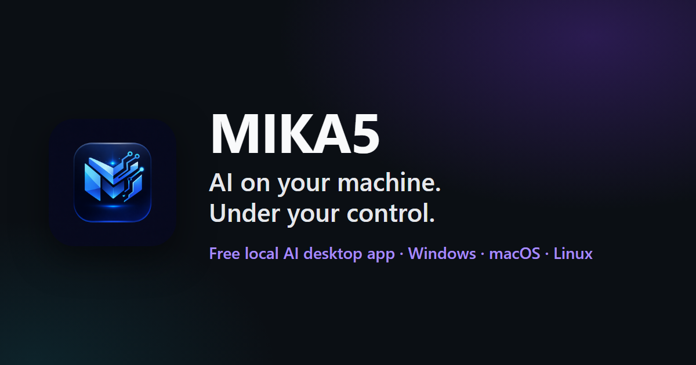

<p align="center">
  
</p>

# MIKA5 — private AI on your computer, free

**Chat with AI models that run on your own machine.** Projects, conversations and a knowledge base built from your documents, all stored locally. No account, no subscription, no telemetry. Cloud providers are optional and never used without your explicit consent.

**IA privada en tu computadora, gratis.** Conversa con modelos que se ejecutan en tu propio equipo. [Leer en español ↓](#en-español)

[](https://github.com/mika5app/mika5-releases/releases/latest)
[](https://github.com/mika5app/mika5-releases/releases)
[](LICENSE)

**[Download v0.3.1](https://github.com/mika5app/mika5-releases/releases/tag/v0.3.1)** · [Website](https://mika5.xyz/) · [Model guide](https://mika5.xyz/models.html) · [White paper](https://mika5.xyz/whitepaper.html)

## Download

| System | Recommended | Also available |
|---|---|---|
| **Windows 10/11** (x64) | [Installer (.exe)](https://github.com/mika5app/mika5-releases/releases/download/v0.3.1/MIKA5-Setup-0.3.1-win-x64.exe) | [Portable](https://github.com/mika5app/mika5-releases/releases/download/v0.3.1/MIKA5-Portable-0.3.1-win-x64.exe) |
| **macOS 12+** Apple Silicon | [DMG (arm64)](https://github.com/mika5app/mika5-releases/releases/download/v0.3.1/MIKA5-0.3.1-mac-arm64.dmg) | [ZIP](https://github.com/mika5app/mika5-releases/releases/download/v0.3.1/MIKA5-0.3.1-mac-arm64.zip) |
| **macOS 12+** Intel | [DMG (x64)](https://github.com/mika5app/mika5-releases/releases/download/v0.3.1/MIKA5-0.3.1-mac-x64.dmg) | [ZIP](https://github.com/mika5app/mika5-releases/releases/download/v0.3.1/MIKA5-0.3.1-mac-x64.zip) |
| **Linux** (x64) | [AppImage](https://github.com/mika5app/mika5-releases/releases/download/v0.3.1/MIKA5-0.3.1-linux-x86_64.AppImage) | [.deb](https://github.com/mika5app/mika5-releases/releases/download/v0.3.1/MIKA5-0.3.1-linux-amd64.deb) · [.rpm](https://github.com/mika5app/mika5-releases/releases/download/v0.3.1/MIKA5-0.3.1-linux-x86_64.rpm) |

MIKA5 uses [Ollama](https://ollama.com) to run local models. Install Ollama first, then pull a chat model and the embedding model used for your documents:

```sh
ollama pull llama3.2
ollama pull nomic-embed-text
```

Not sure which model fits your hardware? See the [model guide](https://mika5.xyz/models.html).

## What you get

- **Runs locally.** Conversations, documents and settings stay in a SQLite database on your computer.
- **Answers from your own documents.** A built-in RAG engine indexes the files you add to a project or a chat and brings the relevant parts into each answer.
- **Projects and chats.** Separate instructions and knowledge per project, export to Markdown, plain text, HTML, Python or PDF.
- **Vision models.** Attach images to a message when the model supports them.
- **Cloud only if you want it.** OpenAI, Anthropic, Groq, Moonshot and Alibaba Cloud Model Studio can be connected with your own API key. Each request shows what would leave your machine and waits for your consent.
- **English and Spanish.**

## First launch: getting past the Windows and macOS warnings

MIKA5 is not code-signed yet, so the system asks you to confirm the first time. It takes three steps, and only once.

**Windows — “Windows protected your PC”**

1. Run the installer. When the blue SmartScreen window appears, click **More info**.
2. The window now shows the file name and “Unknown publisher”. Check that the name is the MIKA5 installer you downloaded.
3. Click **Run anyway**. The installer continues as usual.

If Smart App Control is on, Windows blocks unsigned apps and does not offer “Run anyway”. MIKA5 cannot be installed on that PC until signed builds are available.

**macOS — “Apple could not verify MIKA5”**

1. Open the `.dmg`, drag MIKA5 to Applications and open it once. macOS shows the warning: click **Done**.
2. Open **System Settings → Privacy & Security** and scroll down to Security.
3. Click **Open Anyway** next to MIKA5 and confirm with your password or Touch ID.

On macOS 14 or earlier you can instead right-click the app → **Open** → **Open**.

**Check what you downloaded.** Compare the file with [SHA256SUMS.txt](https://github.com/mika5app/mika5-releases/releases/download/v0.3.1/SHA256SUMS.txt):

```sh
# Windows (PowerShell)
Get-FileHash "MIKA5-Setup-0.3.1-win-x64.exe" -Algorithm SHA256
# macOS
shasum -a 256 MIKA5-0.3.1-mac-arm64.dmg
# Linux
sha256sum MIKA5-0.3.1-linux-x86_64.AppImage
```

## Community

- **Questions and ideas:** [Discussions](https://github.com/mika5app/mika5-releases/discussions)
- **Something broken:** [open an issue](https://github.com/mika5app/mika5-releases/issues)
- **Like it?** A ⭐ on this repository helps other people find MIKA5.
- **MIKA5 Pro** (team collaboration, cloud sync, advanced RAG) is in development and is not part of Community. [Join the waitlist](https://mika5.xyz/#pro).

## Source code

MIKA5 Community is free software under [AGPL-3.0](LICENSE). The source that corresponds to each release is published with it:

- [Source archive for v0.3.1](https://github.com/mika5app/mika5-releases/releases/download/v0.3.1/MIKA5-0.3.1-source.tar.gz) · [Build instructions](https://github.com/mika5app/mika5-releases/releases/download/v0.3.1/BUILDING.md) · [Build metadata](https://github.com/mika5app/mika5-releases/releases/download/v0.3.1/BUILD-METADATA.json)
- [Community information](https://github.com/mika5app/mika5-releases/releases/download/v0.3.1/COMMUNITY.md)

Updates are manual: close MIKA5 and keep a backup of your application data before installing a new version. Optional cloud provider usage may have separate charges from that provider.

---

## En español

**MIKA5 es una aplicación de escritorio de IA que funciona en tu propio equipo, gratis.** Proyectos, conversaciones y una base de conocimiento hecha con tus documentos, todo guardado en local. Sin cuenta, sin suscripción y sin telemetría. Los proveedores en la nube son opcionales y nunca se usan sin tu consentimiento explícito.

**[Descargar v0.3.1](https://github.com/mika5app/mika5-releases/releases/tag/v0.3.1)** · [Sitio web](https://mika5.xyz/es/) · [Guía de modelos](https://mika5.xyz/es/models.html) · [White paper](https://mika5.xyz/es/whitepaper.html)

Los enlaces de descarga por sistema están en la [tabla de arriba](#download). MIKA5 usa [Ollama](https://ollama.com) para ejecutar los modelos locales: instálalo primero y descarga `llama3.2` y `nomic-embed-text`.

### Primer arranque: cómo pasar los avisos de Windows y macOS

MIKA5 todavía no tiene firma de código, así que el sistema te pide confirmar la primera vez. Son tres pasos, una sola vez.

**Windows — «Windows protegió su PC»**

1. Ejecuta el instalador. Cuando aparezca la ventana azul de SmartScreen, pulsa **Más información**.
2. La ventana muestra ahora el nombre del archivo y «Editor desconocido». Comprueba que el nombre es el instalador de MIKA5 que descargaste.
3. Pulsa **Ejecutar de todas formas**. El instalador continúa con normalidad.

Si Smart App Control está activado, Windows bloquea las apps sin firma y no ofrece «Ejecutar de todas formas». MIKA5 no puede instalarse en ese equipo hasta que haya versiones firmadas.

**macOS — «Apple no pudo verificar MIKA5»**

1. Abre el `.dmg`, arrastra MIKA5 a Aplicaciones y ábrela una vez. macOS muestra el aviso: pulsa **Listo**.
2. Abre **Ajustes del Sistema → Privacidad y seguridad** y baja hasta Seguridad.
3. Pulsa **Abrir igualmente** junto a MIKA5 y confirma con tu contraseña o Touch ID.

En macOS 14 o anterior también puedes hacer clic derecho en la app → **Abrir** → **Abrir**.

### Comunidad

- **Preguntas e ideas:** [Discussions](https://github.com/mika5app/mika5-releases/discussions)
- **Algo no funciona:** [abre una incidencia](https://github.com/mika5app/mika5-releases/issues)
- **¿Te gusta?** Una ⭐ en este repositorio ayuda a que más gente encuentre MIKA5.
- **MIKA5 Pro** (colaboración en equipo, sincronización en la nube, RAG avanzado) está en desarrollo y no forma parte de Community. [Apúntate a la lista de espera](https://mika5.xyz/es/#pro).
